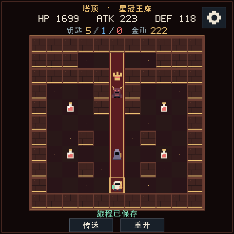

# Mosaico Magic Tower

An original fifty-floor Magic Tower for **ESP-Mosaico** (ESP32-S31, 480×480), built in C with the official Raylib Lite Engine / GSP stack. Author: **Ponkan**.

Current source candidate: **v1.8.0-rc.3**. Adds a persistent battery percentage and charging icon plus dedicated victory/death music. RC2 dark-wall concealed doors, quest item icons and open viewport edges are preserved. Extended hardware playtesting remains open. See [integration status](docs/level-design/PRODUCTION_INTEGRATION.md).

| Title | Chinese dialogue | Throne hall |
|---|---|---|
|  |  |  |

[Published RC2 firmware](https://github.com/Wzdhehe/mosaico-magic-tower/releases/tag/v1.8.0-rc.2). RC3 is the next candidate; its new battery UI and music still require device acceptance.

## Campaign

- Fifty authored maps across Broken Gate, Sunken Hall, Ash Works, Silent Court and Star Crown. Resource thresholds, coloured doors, optional guards and return visits determine the route.
- Floors 1–10 are 11×11; later chapters use 13/15/17/19 tiles. **50F is an 11×11 symmetric throne hall**, visible in one screen.
- An 11×11 viewport pages automatically when the hero enters a continuing edge. Open edges indicate more map; there are no camera buttons or manual panning.
- Eight hidden rooms: step into a darker wall block to reveal its chamber. The 8F NPC teaches this. Discovery persists in checkpoints.
- Three cross-floor errands, a reversible 14F sluice and three optional sigils. None is required by the ordinary winning routes. A distinct terminal robot waits in the optional 47F room.
- Chinese/English coordinate-specific NPC and event dialogue, with explicit pages, 24px Chinese and 16px English body text.
- Deterministic combat previews, confirmation/cancellation, coloured keys, guarded resource choices and shared shop prices of 15/25/35/... gold (+3 per purchase).
- Ten original music loops: title, five regions, final battle, exploration after victory, victory screen and death screen. Four integer voices, bounded echo and no rendering allocations or streamed samples.
- A persistent upper-left battery percentage: white on battery power, green while charging (including full at 100%), with no lightning symbol. Read-only gauge samples every five seconds; only changed values request a frame. A failed/unavailable reading shows `--`.
- One settings button: language, volume, brightness and the readable GitHub address. Preferences are separate from journey data.

## Checkpoints and controls

A new journey and every real stair/warp floor transition save automatically. Same-floor actions, menu visits and death do not overwrite the checkpoint. Failed saves report failure and preserve the previous record.

Footer **Warp / Restart** replaces manual save/load. Six anchors **1/10/20/30/40/50** unlock by chapter completion. Restart offers checkpoint retry, new game and cancel; new game requires another confirmation. Failed retry preserves the live run. After victory, continue exploring and use all six anchors.

Touch a neighbouring tile or swipe to move. Arrow keys/WASD move in Host; Start confirms, Left cancels. The gear has the previous language button's generous touch area.

Save version **v8**, 2632 bytes, includes checksum and semantic validation. **v7 and older journeys are rejected**, because their consumed-tile coordinates belong to different maps. Starting a new game replaces the journey only after confirmation; no NVS erasure is needed.

## Validation

Use Python 3.10+, GCC and Pillow. Set `CC` to the compiler and `MOSAICO_ENGINE_ROOT` to the pinned official engine checkout, then:

```bash
python tools/verify_campaign_release.py
python tools/render_music.py
```

The suite retains logs in `artifacts/campaign-validation/`: five production routes with every-action save roundtrips; 2632 byte-corruption checks; semantic forgeries; actual input/dialogue/errand/checkpoint replay; restart, camera, settings, brightness and idle regressions; 108 real C bilingual page renders; all-track audio bounds; complete official Host ABI replay and screenshots. The four authored ordinary/alternative routes plus the secret/errand route prove specific winning paths, not every possible strategy or final balance. The attack-first witness ends with only 10 HP.

`tests/run_tests.py` runs the current portable model/campaign checks. Historical ten-floor `test_tower.c`, `test_level_design.py`, `test_integration.py`, `test_guarded_forks.py`, old strategy planners and `capture_screens.py` describe v1.6 and are not current acceptance commands. Use `tools/capture_campaign_host.py` for actual production gameplay screenshots; `capture_campaign_design.py` is a camera-only map QA facade.

## Official build

This repository is a project inside the official ESP-Mosaico workspace, not a standalone ESP-IDF app. Put a real source copy under `projects/magic_tower` and preserve its relative component overrides. Verify ESP-IDF commit `7b9cc1ac79f865983f59bb8ff3ff43eb74ff1dbe` and engine commit `ca3200a6b7f63e2bdea07851e19fdbd3a42eb742`.

A fresh engine needs `tools/patches/raylib-lite-engine-settings-display.patch` for existing display ownership integration. Inspect existing edits first; the development workspace already has it. Never reset or apply it twice.

From the official workspace, follow its build-doctor skill, then:

```bash
python mosaico.py game sim --project projects/magic_tower --headless --frames 120
python mosaico.py game build --project projects/magic_tower
```

Installation is a separate step through the official `mosaico.py iris` workflow after device identity, mode and layout compatibility checks. Preserve retained Vibe Mode firmware and the immutable partition prefix; do not use direct flash commands.

## Sources

`main/tower.c` owns gameplay and save validation; `tower_floors.c` contains the exact approved maps. `game.c` owns input and screen state; `game_view.c` is shared Host/device drawing. `campaign_dialogue.h` and `game_music_score.h` are deterministic generated tables.

Design sources, maps, copy, music and route reports are under [assets_src/level_design](assets_src/level_design) and [docs/level-design](docs/level-design). Reproduce generated tables with `tools/gen_campaign_dialogue.py` and `tools/gen_campaign_music.py`; regenerate CJK glyphs with `tools/gen_ui_font.py` (optional `MOSAICO_UI_FONT` override). Keep all three in sync.

Operation-driven drawing and the 15 Hz active cap remain in place. Host CPU timings do not establish device temperature, battery life, touch feel or speaker quality. This revision still needs hardware acceptance.

## License

Project code, original maps, procedural art and scores use MIT; see [LICENSE](LICENSE) and [NOTICE](NOTICE) for retained upstream notices. No third-party map, sprite or music samples are bundled.
