# Mosaico Magic Tower

A ten-floor Magic Tower game for the **ESP-Mosaico** handheld (ESP32-S31, 480×480 display), written in C on top of the official Raylib Lite Engine / GSP stack.

The game is a compact, original take on the classic key-and-door dungeon formula: deterministic combat previews, coloured keys, shops, NPC story scenes, an original generated soundtrack, and a crisp pixel UI rendered entirely in code.

Current release: **v1.5** — see [CHANGELOG.md](CHANGELOG.md).

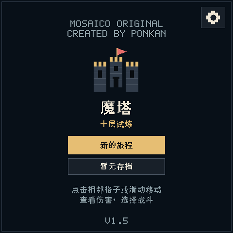

## Features

- **Ten floors** with stairs, coloured doors, shops, treasure, and a final boss.
- **Cross-floor key puzzle**: the red key behind floor 3's blue door is needed on floor 5; its blue key waits on floor 4.
- **Deterministic combat** with damage preview, confirm/cancel, and no HP loss when a fight is refused.
- **NPC dialogue** on every floor, reusing the game's modal UI, in Chinese and English.
- **Pickup feedback** with exact values (`Healing potion HP +30`, `Attack gem ATK +5`, …).
- **Three original RPG loops**: a warm title theme, quiet lower-tower exploration and a more urgent upper-tower theme, using the same bounded C synthesizer on device and in previews.
- **One settings button** at the top right: Chinese/English, volume, brightness and the readable GitHub repository address. Preferences survive restarting and loading journeys.
- **Ponkan** credited on the welcome screen.
- **Versioned transactional saves** (2 KiB, FNV checksum + semantic validation) in NVS.
- **Operation-driven rendering**: redraw after input, static idle sprites, and a 15 Hz active update cap.
- **TE-synchronized output** through GSP composition; the user currently reports no visible tearing on the device.

| Exploration | Combat | Merchant |
|---|---|---|
| 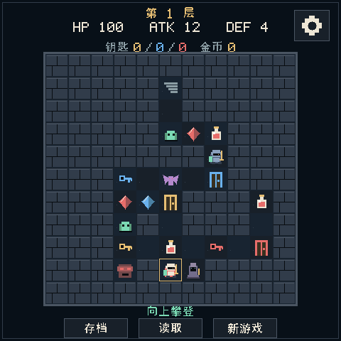 | 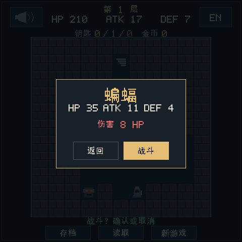 | 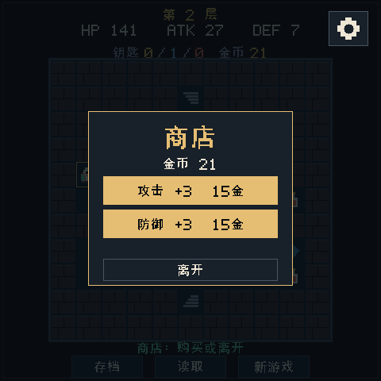 |

| NPC scene | Pickup feedback | Summit |
|---|---|---|
| 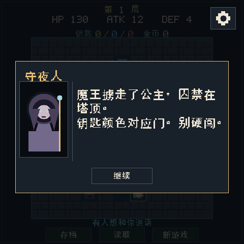 | 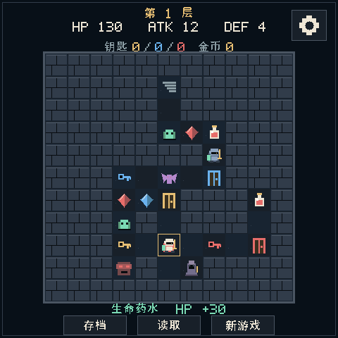 | 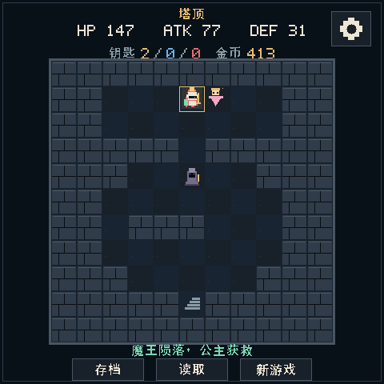 |

## Controls

| Action | Touch | Keyboard |
|---|---|---|
| Move one tile | Tap a neighbouring tile, or swipe | Arrow keys / WASD |
| Confirm fight | Tap **Fight** | Start / F / Ctrl |
| Cancel fight | Tap **Back** | Left |
| Save / Load / New | Footer buttons | — |
| Settings | Gear button, top right | — |
| Language / Volume / Brightness | Choices and sliders inside settings | — |

## Floor overview

Screenshots are rendered from the same C renderer used on the device.

| Floor | Theme |
|---|---|
| 1 | Gatehouse — first fights and yellow door tutorial |
| 2 | Merchant hall — shop, first blue gate and knight |
| 3 | Ghost gallery — blue-locked western vault hides a red key |
| 4 | Guard barracks — mandatory blue gate, red side vault, key for floor 3 |
| 5 | Sealed archive — red seal requires going back to floor 3 |
| 6 | Collapsed stair — two routes and optional expensive fights |
| 7 | Chapel — eastern wraith protects the red key needed next |
| 8 | Prison cells — a red seal blocks the route onward |
| 9 | Throne antechamber — choose which guardian to fight |
| 10 | Demon throne — a boss that cannot be bypassed |

<p float="left">
  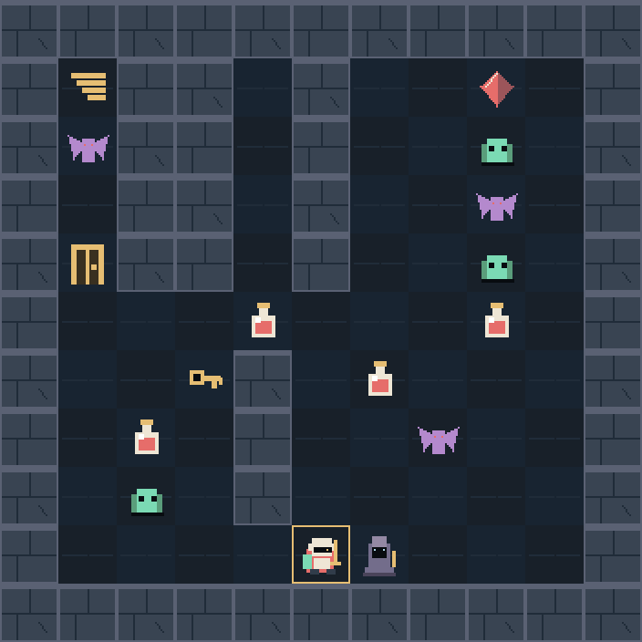
  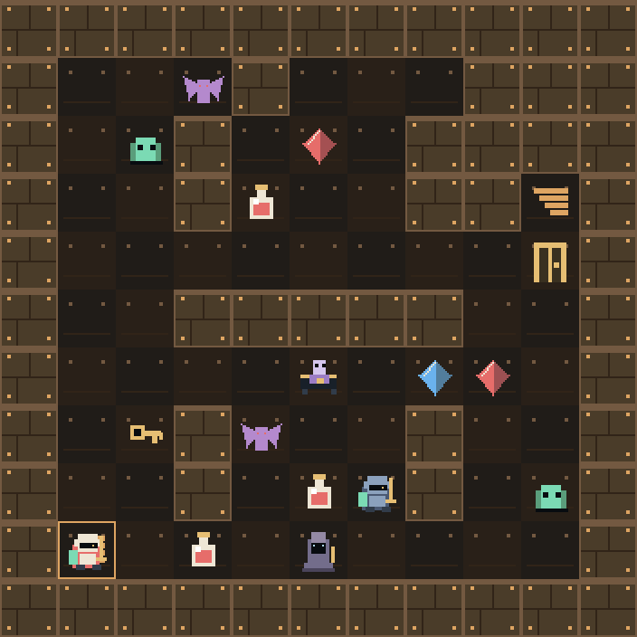
  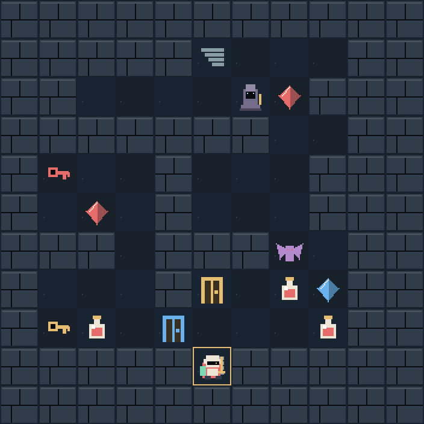
  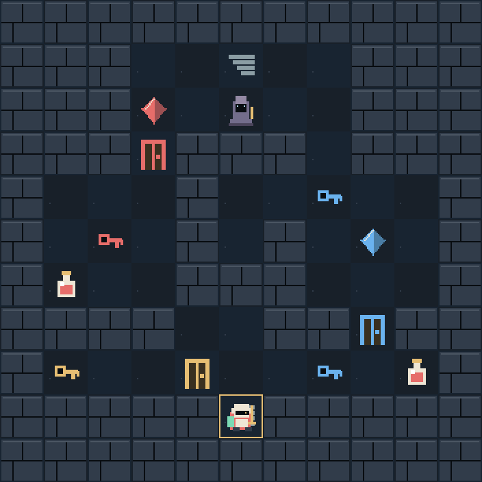
  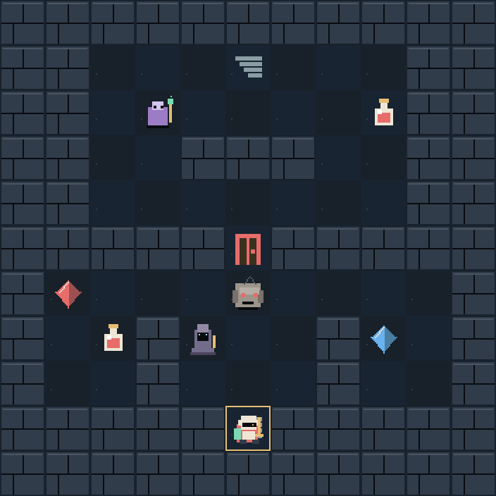
  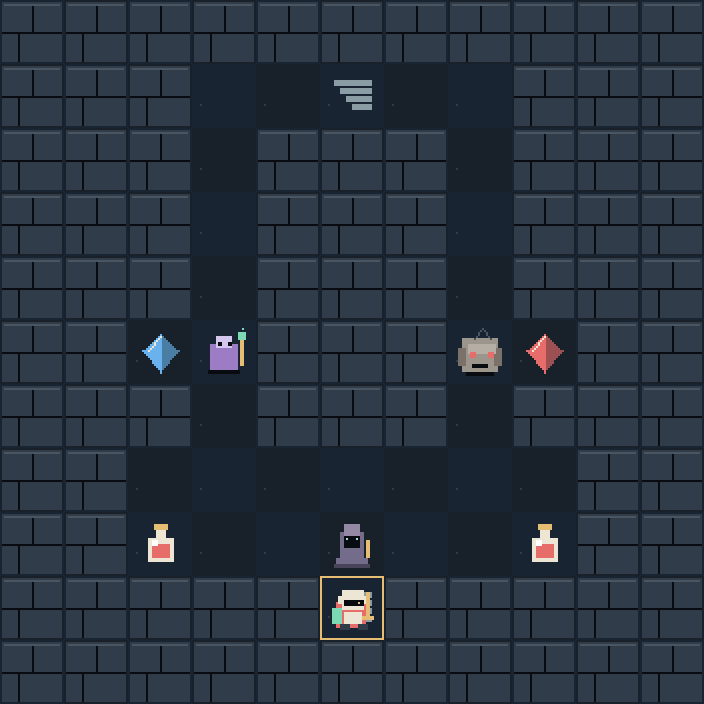
  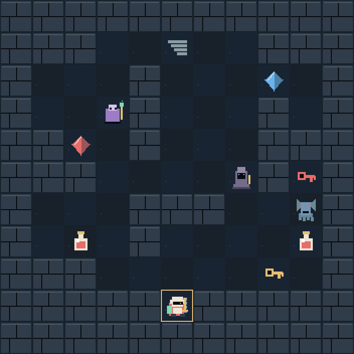
  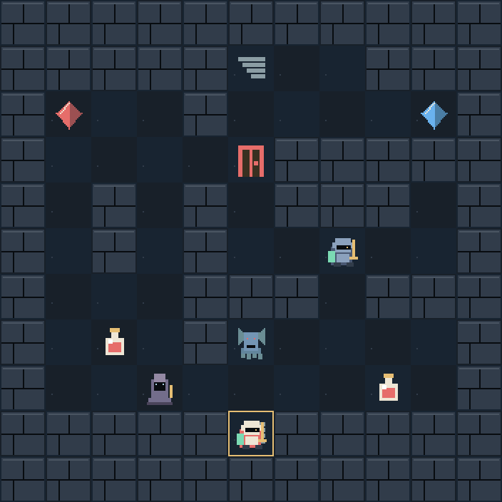
  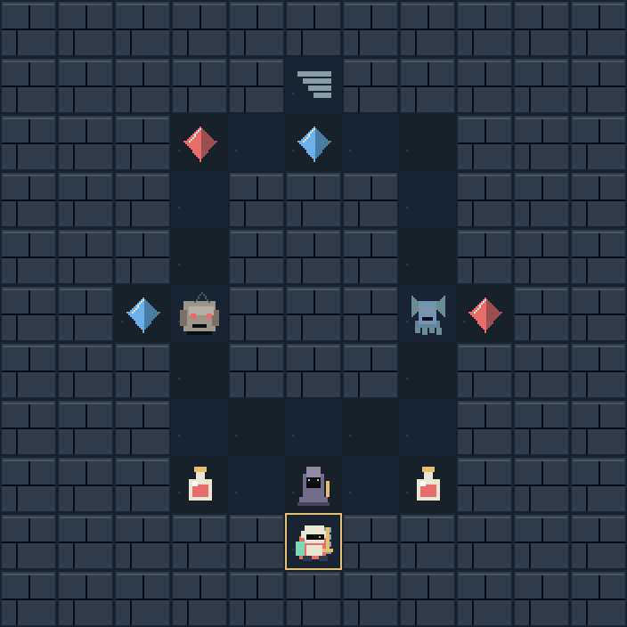
  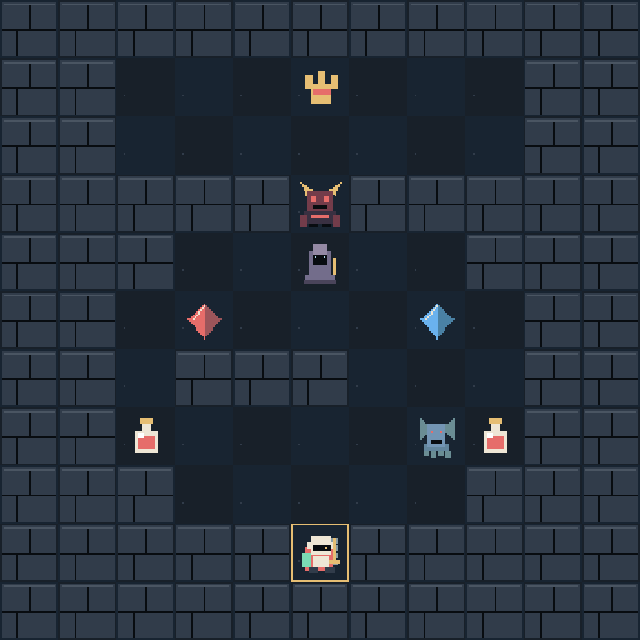
</p>

> **Design:** all ten floors are hand-authored 11×11 rooms and corridors with
> asymmetric stairs, supply alcoves, optional fights and a cross-floor key
> detour. Floors 6 and 9 each offer a guarded attack/defence fork. A larger
> scrolling map with a fixed camera remains a separate future feature.

## Building

This repository is a **project** for the ESP-Mosaico workspace, not a standalone ESP-IDF application. The component manager uses `override_path` entries that resolve inside the official workspace.

1. Use the official ESP-Mosaico development workspace (the `esp-mosaico-vibe` checkout used for this project).
2. Place this repository at `projects/magic_tower` inside that workspace.
3. Build with the official CLI:

This revision also requires the checked-in engine integration patch against
the pinned `ca3200a6b7f63e2bdea07851e19fdbd3a42eb742` engine. It contains the
existing TE integration and serializes brightness changes with display work.
For a fresh workspace, check and apply it before building:

```bash
git -C submodule/raylib-lite-engine apply --check ../../projects/magic_tower/tools/patches/raylib-lite-engine-settings-display.patch
git -C submodule/raylib-lite-engine apply ../../projects/magic_tower/tools/patches/raylib-lite-engine-settings-display.patch
```

If the engine already has local changes, inspect them first. The development
workspace already contains this patch; do not apply it twice or reset its edits.

```bash
python mosaico.py game build --project projects/magic_tower
```

The project targets ESP-IDF 6.x and the component versions pinned in `dependencies.lock`.

### Install on hardware

Only use the official Iris update path; never flash the factory/Vibe Mode partitions directly:

```bash
python mosaico.py iris system-update --project projects/magic_tower
```

The update only writes the application partition; Vibe Mode and the recovery firmware are preserved.

## Tests

The gameplay model is portable C and can be tested without hardware.

```bash
python tests/test_level_design.py
python tests/test_ui_glyphs.py
python tools/magic_tower_route.py
python tests/run_tests.py --label local
python -m unittest discover -s tests -p test_guarded_forks.py
python tests/run_strategy_routes.py
python tests/run_game_timing.py    # portable operation-driven + CJK lookup checks
python tests/run_render_schedule.py # real RGB565 idle/operation/retry checks
python tests/run_preferences_storage.py # separate validated transactional preferences
python tests/run_game_music.py    # exact C core, limits, mute and deterministic chunks
python tools/render_music.py     # WAV previews from the device's C synthesizer
python tests/test_integration.py   # requires the host Raylib Lite engine
python tools/capture_screens.py    # regenerates docs/images from the host renderer
```

`tests/win_route.json` and `tests/win_route.h` are generated by `tools/magic_tower_route.py`. The planner replays the real map data, including the floor 3/4/5 key detour, and the generated replay route clears all ten floors. `tests/run_strategy_routes.py` replays all four floor 6 / floor 9 guard combinations in the real C model, exporting and importing the 2 KiB save after every action. `tests/test_ui_glyphs.py` fails when authored text needs a glyph that `main/ui_font.h` does not contain.

`tools/capture_screens.py` and `tests/test_integration.py` must run from an official ESP-Mosaico workspace checkout, because both resolve the shared Host engine next to the project. The screenshot tool drives the game through the Host ABI and only crops the dungeon out of those frames; it does not reimplement rendering.

## Source layout

See the [roadmap](docs/ROADMAP.md), [performance notes](docs/PERFORMANCE.md),
and [settings/music notes](docs/SETTINGS_MUSIC.md) for design and validation details.

| Path | Purpose |
|---|---|
| `main/tower.[ch]` | Portable model: maps, combat, keys/doors, shops, save format |
| `main/game.[ch]` | Input, screen state machine, save adapter, music/gain state |
| `main/game_view.c` | Shared C renderer: pixel art, CJK bitmap text, modals |
| `main/game_music.[ch]`, `main/game_music_score.h` | Portable synthesizer and original scores |
| `main/game_audio.c` | ESP codec task and atomic audio controls |
| `main/game_preferences.[ch]` | Validated, versioned four-byte preference record |
| `main/ui_font.h` | Generated 16×16 CJK glyph subset (do not hand-edit) |
| `main/main.c` | Device entry point and NVS persistence |
| `main/raylib_screen_mirror.[ch]` | Iris screenshot/input backend registration |
| `tools/` | Route planner, font generator, screenshot and build scripts |
| `tests/` | Model tests, host integration tests, generated win route |

## Design notes

### Settings and original soundtrack

The title credits Ponkan. The settings panel shows
`github.com/Wzdhehe/mosaico-magic-tower` as readable text, because the handheld
does not provide a web browser. Volume ranges from 0 to 100; brightness from
10 to 100. Defaults are Chinese, volume 45 and brightness 40. Brightness uses
the official BSP API. Preferences are saved once when a changed panel closes:
device NVS `magic_tower/prefs1`, or Host `magic_tower.save.prefs`. They are
independent of the existing journey record, which remains v4 and 2048 bytes.
Failed preference writes retain the previous record and display a retry notice.

All three 16-bar scores and synthesis provenance are documented in
[music sources](assets_src/music/README.md). Four fixed voices, a bounded echo
and integer rendering avoid runtime assets and render-time allocations. Muting
skips synthesis while advancing the musical timeline. Host timing establishes
algorithm cost only; speaker quality and power consumption require device checks.

### Map revision and saves

The layout update bumps the NVS save wire version from v3 to v4 so older
position/map snapshots are rejected instead of being loaded into changed
geometry. Start a new journey after updating; a v3 record is rejected rather
than loaded into the new floors, and until you save again the title screen
offers no saved journey. There is nothing to repair by hand: **do not erase or
rewrite NVS** to work around the rejection, because the v3 record is simply
ignored and a new game begins on floor one.

### Guarded-fork strategies and merchant prices

Floors 6 and 9 have distinct attack/defence reward pockets behind
individual guardians. Both routes can lead upstairs, but taking the other
reward still requires defeating its defender. Both merchant attributes use
a shared rising price (15, 25, 35, ... gold): every purchase raises the next
price by 10 gold for both attributes, while each purchase still grants +3. See
[design brief](docs/GUARDED_FORK_DESIGN.md).

## Performance

The game redraws **after operations**, with a **15 Hz** maximum active update
cadence. Idle sprites are static; pickup and save/load feedback stays visible
until a relevant operation replaces it. The official engine idle callback skips
settled update/render work while continuing to poll touch. Failed frame
acquisition/submission is retried. CJK lookup uses binary search, and rendering
uses one full-canvas clear. See [performance notes](docs/PERFORMANCE.md) for
verification and remaining hardware measurements. **No thermal benefit is
claimed until Mosaico measurements are recorded.**

## License

Project code is released under the **MIT License**; see [LICENSE](LICENSE). Some files are adapted from Espressif Apache-2.0 templates and retain their SPDX headers — see [NOTICE](NOTICE). The game art is drawn procedurally in `game_view.c`; no third-party sprites, music, or map data are included.
